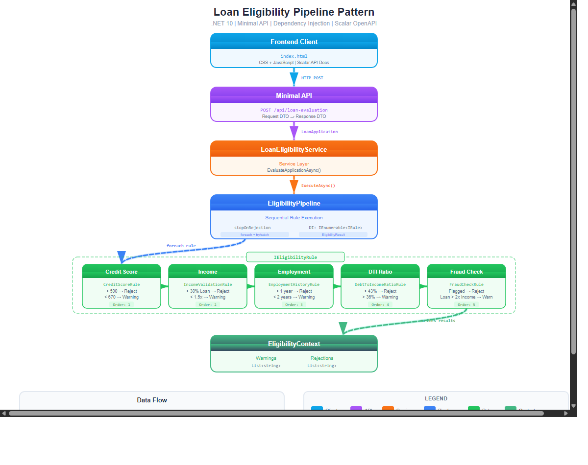

# Pipeline Pattern Demo / 贷款资格流水线模式

基于 .NET 10 的 Pipeline Pattern 演示项目，用于贷款资格评估系统。

## Architecture / 架构图



## Quick Start / 快速开始

```bash
# 运行 API 项目
dotnet run --project PipelinePatternDemo.Api

# 或运行控制台演示
dotnet run --project PipelinePatternDemo
```

- 前端页面: `http://localhost:4520`
- API 文档 (Scalar): `http://localhost:4520/scalar/v1`

## Project Structure / 项目结构

```
PipelinePatternDemo/           # 核心类库 - Pipeline 模式实现
├── Models/LoanApplication.cs  # 贷款申请领域模型
├── Pipeline/
│   ├── IEligibilityRule.cs    # 规则接口
│   └── EligibilityContext.cs  # 管道上下文（累积警告/拒绝）
├── Rules/
│   ├── EligibilityPipeline.cs # 管道编排器 + EligibilityResult
│   ├── CreditScoreRule.cs     # 信用评分 (Order: 1)
│   ├── IncomeValidationRule.cs # 收入验证 (Order: 2)
│   ├── EmploymentHistoryRule.cs # 就业历史 (Order: 3)
│   ├── DebtToIncomeRatioRule.cs # 债务收入比 (Order: 4)
│   └── FraudCheckRule.cs      # 欺诈检查 (Order: 5)
└── Services/LoanEligibilityService.cs

PipelinePatternDemo.Api/       # Web API 项目
├── Program.cs                 # Minimal API + DI + Scalar
├── DTOs/                      # 请求/响应 DTO
└── wwwroot/                   # 前端 (HTML/CSS/JS)
```

## How It Works / 工作原理

1. Client 提交 `POST /api/loan-evaluation` 请求
2. API 将 Request DTO 映射为 `LoanApplication` 领域模型
3. `LoanEligibilityService` 委托给 `EligibilityPipeline`
4. Pipeline 顺序执行所有 `IEligibilityRule` 实例
5. 每条规则评估后向 `EligibilityContext` 写入警告或拒绝
6. 遇到拒绝时可选择中断管道（`stopOnRejection = true`）
7. 返回 `EligibilityResult`（是否批准、拒绝原因、警告列表）

## Tech Stack / 技术栈

- .NET 10
- ASP.NET Core Minimal API
- Microsoft.Extensions.DependencyInjection
- Microsoft.Extensions.Logging
- Scalar (OpenAPI 文档)
