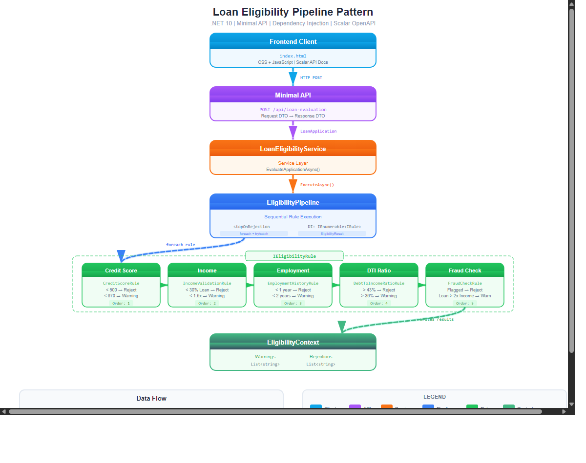

# Pipeline Pattern Demo / Pipeline de Elegibilidade de Empréstimo

Projeto de demonstração do **Pipeline Pattern** em .NET 10, aplicado a um sistema de análise de elegibilidade de empréstimos.

> Quer entender os padrões de projeto usados aqui? Veja [DESIGN_PATTERNS.md](DESIGN_PATTERNS.md).

## Arquitetura



## Início rápido

```bash
# Rodar o projeto da API
dotnet run --project PipelinePatternDemo.Api

# Ou rodar a demo no console
dotnet run --project PipelinePatternDemo
```

- Front-end: `http://localhost:4520`
- Documentação da API (Scalar): `http://localhost:4520/scalar/v1`

## Estrutura do projeto

```
PipelinePatternDemo/             # Biblioteca principal - implementação do Pipeline
├── Models/LoanApplication.cs    # Modelo de domínio da proposta de empréstimo
├── Pipeline/
│   ├── IEligibilityRule.cs      # Interface das regras
│   └── EligibilityContext.cs    # Contexto do pipeline (acumula avisos/reprovações)
├── Rules/
│   ├── EligibilityPipeline.cs   # Orquestrador do pipeline + EligibilityResult
│   ├── CreditScoreRule.cs       # Score de crédito (Order: 1)
│   ├── IncomeValidationRule.cs  # Validação de renda (Order: 2)
│   ├── EmploymentHistoryRule.cs # Histórico de emprego (Order: 3)
│   ├── DebtToIncomeRatioRule.cs # Índice de endividamento (Order: 4)
│   └── FraudCheckRule.cs        # Verificação de fraude (Order: 5)
└── Services/LoanEligibilityService.cs

PipelinePatternDemo.Api/         # Projeto Web API
├── Program.cs                   # Minimal API + DI + Scalar
├── DTOs/                        # DTOs de requisição/resposta
└── wwwroot/                     # Front-end (HTML/CSS/JS)
```

## Como funciona

1. O cliente envia uma requisição `POST /api/loan-evaluation`
2. A API converte o DTO de requisição no modelo de domínio `LoanApplication`
3. O `LoanEligibilityService` delega o trabalho para o `EligibilityPipeline`
4. O pipeline ordena as regras pelo `Order` e executa cada `IEligibilityRule` em sequência
5. Cada regra registra avisos ou reprovações no `EligibilityContext`
6. Ao encontrar uma reprovação, o pipeline pode ser interrompido (`stopOnRejection = true`)
7. É devolvido um `EligibilityResult` (aprovado ou não, motivos da reprovação e lista de avisos)

## Tecnologias

- .NET 10
- ASP.NET Core Minimal API
- Microsoft.Extensions.DependencyInjection
- Microsoft.Extensions.Logging
- Scalar (documentação OpenAPI)
